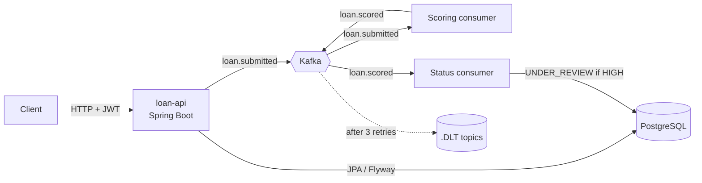

# loan-api


A REST API for loan applications, built with Java 21 and Spring Boot. Officers log in with a JWT, submit loan applications that are stored in PostgreSQL, and every new application starts an event-driven flow over Apache Kafka: it is scored, and high-risk loans are moved to `UNDER_REVIEW` automatically.

It is a learning project in the same loan domain as my [loan-risk-salesforce](https://github.com/HemHarshith/loan-risk-salesforce) project. The scoring step here is a **placeholder rule**, not the trained model (see [Known limitations](#known-limitations)).

## What it does

- Register and log in; passwords are stored as BCrypt hashes and logins return a signed JWT.
- Create, list and read loan applications (any logged-in user).
- Change a loan's status or delete it (ADMIN only).
- Validate input and return clear JSON errors (400, 401, 403, 404, 409).
- After a loan is saved, publish a `loan.submitted` event to Kafka. A consumer scores the loan and publishes `loan.scored`; a second consumer applies the result to the database.
- Failed messages are retried and then moved to a dead-letter topic, so one bad message never blocks the rest.

## Architecture



**Request path:** Tomcat, Spring Security filter chain (JWT check), DispatcherServlet, controller, `@Valid`, service (`@Transactional`), repository, PostgreSQL.

**Event path:** the service saves the loan and raises an application event. The event is turned into a Kafka message only **after the database transaction commits**, so a rolled-back save never produces an event.

## Tech stack

| Area | Tools |
|---|---|
| Language / framework | Java 21, Spring Boot 4.1.2, Spring MVC, Bean Validation |
| Data | PostgreSQL 17, Spring Data JPA (Hibernate), Flyway migrations |
| Security | Spring Security, JWT (HS256), BCrypt, role-based access (OFFICER / ADMIN) |
| Messaging | Apache Kafka (KRaft mode), Spring Kafka, retry and dead-letter topics |
| Testing | JUnit 5, Mockito, MockMvc, Testcontainers (PostgreSQL), embedded Kafka, Awaitility |
| Build / run | Maven Wrapper, Docker, Docker Compose |
| CI | GitHub Actions (build, test, Docker image build, publish to GitHub Container Registry) |

## Endpoints

| Method | Path | Access | Result |
|---|---|---|---|
| POST | `/api/auth/register` | public | creates an OFFICER, 201 (409 if the username is taken) |
| POST | `/api/auth/login` | public | `{accessToken, tokenType}` (401 for any bad login) |
| GET | `/api/ping`, `/actuator/health` | public | health checks |
| POST | `/api/loan-applications` | logged in | 201 + `Location` header |
| GET | `/api/loan-applications` | logged in | list of loans |
| GET | `/api/loan-applications/{id}` | logged in | one loan, or 404 |
| PATCH | `/api/loan-applications/{id}/status` | ADMIN | body `{"status":"APPROVED"}` |
| DELETE | `/api/loan-applications/{id}` | ADMIN | 204 No Content |

Statuses: `SUBMITTED`, `UNDER_REVIEW`, `APPROVED`, `REJECTED`. New loans always start as `SUBMITTED`.
Validation: age 18-100, amount at least 1000, duration 6-120 months, name and purpose required.

## Kafka event flow

| Topic | Written by | Read by | Meaning |
|---|---|---|---|
| `loan.submitted` | `LoanEventPublisher` | `LoanScoringConsumer` (group `loan-scoring`) | a loan was saved |
| `loan.scored` | `LoanScoringConsumer` | `LoanScoredConsumer` (group `loan-status-updater`) | a loan was scored |
| `loan.submitted.DLT`, `loan.scored.DLT` | error handler | nobody (inspected by hand) | messages that failed after retries |

- Each topic has 3 partitions. The loan id is the message key, so events for one loan stay in order.
- The producer waits for the broker to confirm (`acks=all`) and gives up after 3 seconds if Kafka is unreachable, without failing the request (the loan is already saved).
- A failing message is retried 3 times, 1 second apart, then moved to `<topic>.DLT`.
- `applyScore` is idempotent: the status changes only while the loan is still `SUBMITTED`, so a duplicate message changes nothing.
- Placeholder score: `min(1, (loanAmount / durationMonths) / 50000)`. Bands: LOW below 0.15, MEDIUM from 0.15, HIGH from 0.5. Only HIGH moves a loan to `UNDER_REVIEW`.

## Run it with Docker (recommended)

Requires Docker Desktop. This starts PostgreSQL, Kafka and the app together.

```powershell
# PowerShell, from the project folder. Secrets live only in this terminal, never in files.
$env:DB_PASSWORD = "choose-a-password"
$b = New-Object byte[] 48; [Security.Cryptography.RandomNumberGenerator]::Create().GetBytes($b); $env:JWT_SECRET = [Convert]::ToBase64String($b)

docker compose up --build -d
docker ps --format "table {{.Names}}\t{{.Status}}"   # wait until db, kafka and app are (healthy)
```

Bash equivalent: `export DB_PASSWORD=...` and `export JWT_SECRET=$(openssl rand -base64 48)`.

The first start creates an empty database, so register before logging in. Stop with `docker compose down` (keeps data) or `docker compose down -v` (also deletes the database volume).

> PostgreSQL only reads `POSTGRES_PASSWORD` when it first creates its volume. If you start the stack later with a different `DB_PASSWORD`, you get `password authentication failed`. Use the original password, or run `docker compose down -v` and start again.

## Try it

```powershell
$base = "http://localhost:8080"
Invoke-RestMethod -Method Post -Uri "$base/api/auth/register" -ContentType "application/json" -Body '{"username":"officer1","password":"a-strong-password-1"}'
$login = Invoke-RestMethod -Method Post -Uri "$base/api/auth/login" -ContentType "application/json" -Body '{"username":"officer1","password":"a-strong-password-1"}'
$h = @{ Authorization = "Bearer $($login.accessToken)" }

# High risk: 1,500,000 over 12 months scores 1.0 -> moves to UNDER_REVIEW
Invoke-RestMethod -Method Post -Uri "$base/api/loan-applications" -Headers $h -ContentType "application/json" -Body '{"applicantName":"Big Loan","age":40,"loanAmount":1500000,"durationMonths":12,"purpose":"Business"}'

# Low risk: 120,000 over 24 months scores 0.10 -> stays SUBMITTED
Invoke-RestMethod -Method Post -Uri "$base/api/loan-applications" -Headers $h -ContentType "application/json" -Body '{"applicantName":"Small Loan","age":30,"loanAmount":120000,"durationMonths":24,"purpose":"Education"}'

Start-Sleep -Seconds 3
Invoke-RestMethod -Uri "$base/api/loan-applications" -Headers $h
docker compose logs app | Select-String "Published loan|Scoring loan|moved to UNDER_REVIEW"
```

Public registration always creates an OFFICER. Admin-only calls (status change, delete) need an ADMIN, which is promoted by hand in the database in this project.

## Run locally (without the app container)

1. Install JDK 21 and a local PostgreSQL with a database named `loanapi`.
2. Start only Kafka: `docker compose -f docker-compose.kafka.yml up -d`
3. Set `DB_PASSWORD` and `JWT_SECRET` in your terminal, then `.\mvnw spring-boot:run`

## Tests

25 tests: `.\mvnw clean test`

| Class | Tests | What it checks | Needs |
|---|---|---|---|
| `LoanApplicationServiceTest` | 7 | create, read, status change (no `save` call, dirty checking), delete, not-found cases | nothing |
| `LoanApplicationServiceScoreTest` | 5 | `applyScore`: HIGH moves to UNDER_REVIEW, LOW does not, duplicates change nothing, decided loans are not overwritten, missing loans are skipped | nothing |
| `LoanApplicationControllerTest` | 11 | validation errors, 401 / 403 / 404, ADMIN-only rules, with MockMvc and a mocked service | nothing |
| `LoanApiApplicationTests` | 1 | the whole application context starts | PostgreSQL and the two environment variables |
| `LoanKafkaFlowTest` | 1 | end to end: create a loan, event, scoring, status update in the database | Docker Desktop (Testcontainers PostgreSQL); Kafka runs embedded in the test |

The Kafka test sets the JVM timezone to `Asia/Kolkata` because some JVMs report the old name `Asia/Calcutta`, which the `postgres:17` image rejects.

## CI

`.github/workflows/ci.yml` runs on every push to `main` and every pull request: checkout, Java 21 with Maven cache, `./mvnw verify` (all tests against a PostgreSQL service container), then a Docker image build. On pushes to `main`, after the tests pass, the image is published to GitHub Container Registry as `ghcr.io/hemharshith/loan-api` (tags `latest` and the commit SHA). Pull requests build the image but do not publish it. CI uses made-up values for `DB_PASSWORD` and `JWT_SECRET`; no real secret is in the repository.

## Design decisions

- **Layers:** controller (HTTP only), service (rules and transactions), repository (database). Replacing in-memory storage with PostgreSQL did not change the controller.
- **Three shapes per loan:** request, response and entity, so clients cannot set server-controlled fields like `id` or `status`.
- **Flyway owns the schema,** Hibernate only validates (`ddl-auto=validate`).
- **Stateless JWT** in a header, so CSRF protection is off and there are no sessions.
- **Same 401 for unknown user and wrong password,** to avoid revealing which usernames exist.
- **Event after commit:** the Kafka message is sent in `AFTER_COMMIT`, so it never describes a rolled-back save.
- **Retry then dead-letter** keeps one poison message from blocking a partition.
- **Embedded Kafka in the integration test:** a Kafka Testcontainer exited at start-up on my Windows Docker setup, so the broker runs inside the test JVM; PostgreSQL still runs in Testcontainers.

## Known limitations

- **The scoring is a placeholder** (monthly repayment size), not a trained model, and it runs inside the same application as a separate listener, not as a separate service.
- No outbox pattern: if the application crashes after the database commit and before the Kafka send, the event is lost.
- The dead-letter topics are not consumed or monitored; I inspect them by hand.
- Single Kafka broker, plain text, JSON strings, no schema registry.
- Roles are enforced only on status change and delete; any logged-in user can read all loans.
- Registration is open and always creates an OFFICER; admins are promoted by hand in SQL.
- No status-transition rules, audit trail, refresh tokens, password reset, rate limiting, pagination, or OpenAPI docs.
- The JWT role mapping was checked manually, not by an automated end-to-end test.
- Plain HTTP only. Not deployed anywhere.

## Project structure

```
src/main/java/com/hemharshith/loanapi/
  LoanApiApplication.java          application entry point
  PingController.java              /api/ping
  GlobalExceptionHandler.java      exceptions to JSON errors
  loan/                            entity, repository, service, controller, DTO records, LoanSubmittedEvent
  auth/                            users, BCrypt, JWT, SecurityConfig, login and register
  messaging/                       Kafka publisher, consumers, topics and error handling
src/main/resources/                application.properties, db/migration (Flyway)
src/test/java/                     unit, web-layer and integration tests
Dockerfile, docker-compose.yml, docker-compose.kafka.yml, .github/workflows/ci.yml
```
